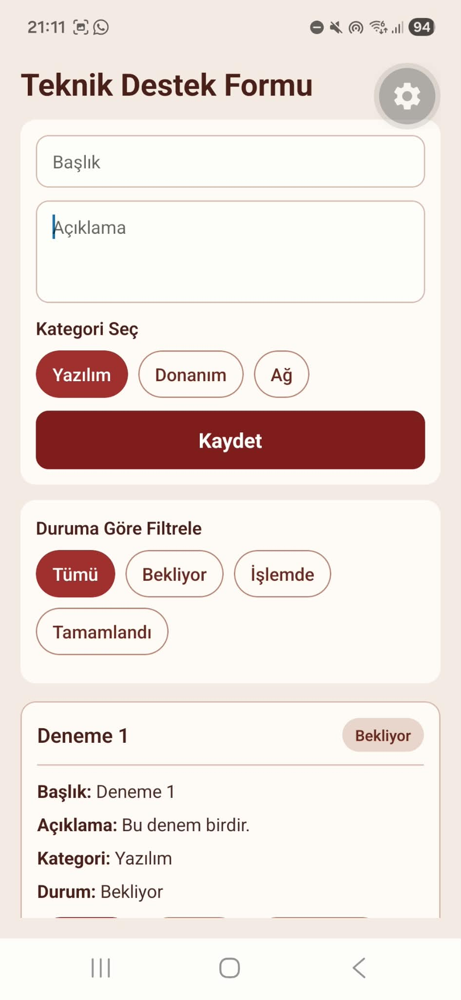
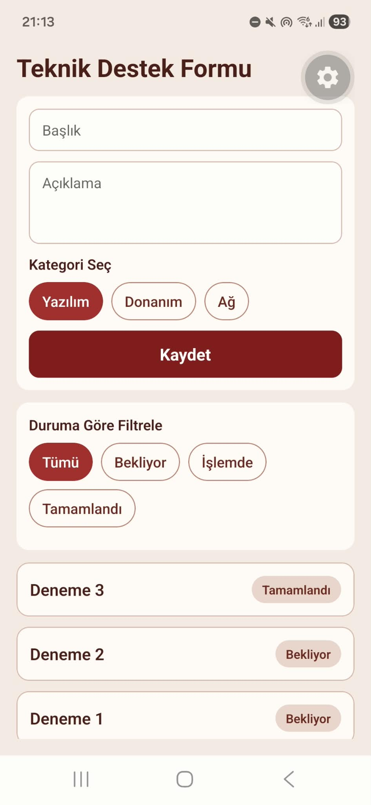
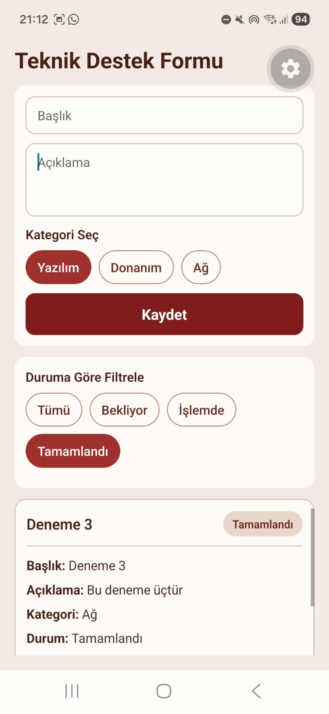
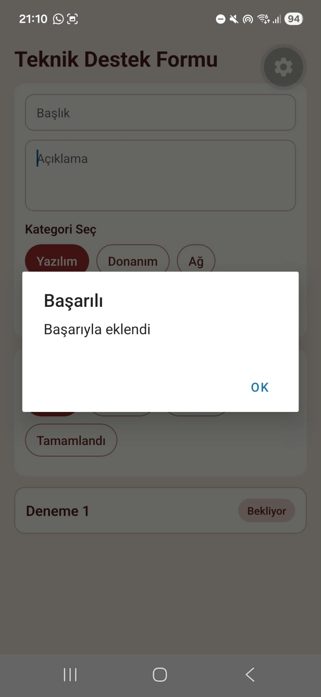
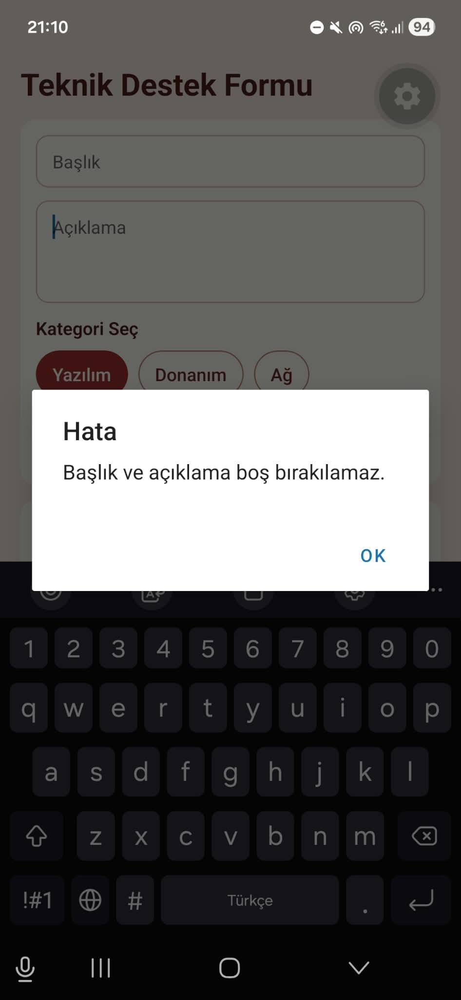
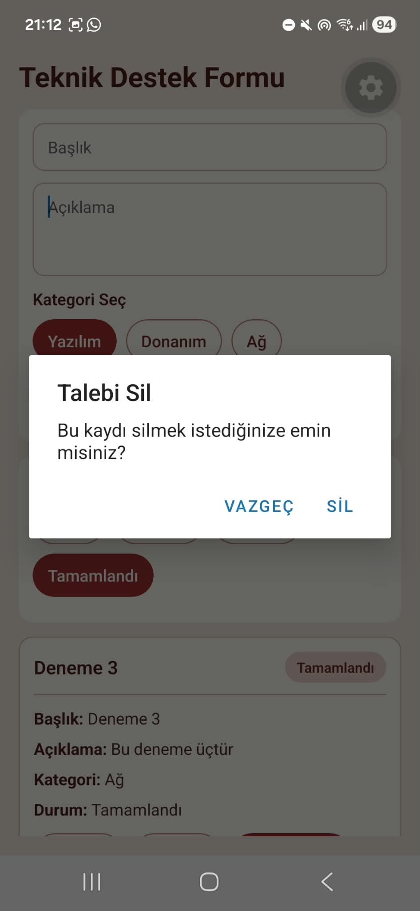
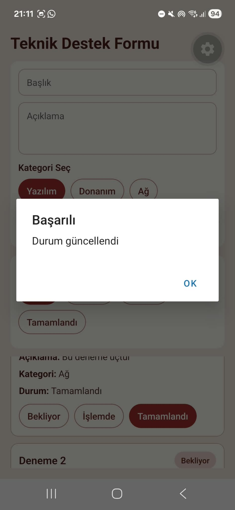

# Akıllı Arıza Talep Yönetimi (Hafta 5 Mini Proje)

Bu proje, Mobil Programlama dersi Hafta 5 laboratuvar çalışması kapsamında geliştirilmiş bir teknik destek ve arıza bildirim uygulamasıdır. React Native ve Expo SDK 57 kullanılarak geliştirilmiştir.

## Kurulum ve Çalıştırma Yönergeleri

Projeyi kendi bilgisayarınızda çalıştırmak için aşağıdaki adımları izleyin:

1. Proje dizinine terminal ile gidin.
2. Gerekli paketleri yükleyin:
   ```bash
   npm install
   ```
3. Expo sunucusunu başlatın:
   ```bash
   npx expo start
   ```
4. Terminalde beliren QR kodu Expo Go (iOS/Android) uygulaması ile okutarak cihazınızda test edebilirsiniz.

## Uygulama Özellikleri
* Yeni destek talebi oluşturma (Başlık, Açıklama, Kategori).
* Boş veya geçersiz girişler için anlık doğrulama (Validation).
* Eklenen talepleri liste üzerinde görüntüleme.
* Taleplere dokunarak detayları (kategori, durum) genişletme.
* Uzun basarak talebi silme (onay penceresi ile).
* Talebin durumunu (Bekliyor, İşlemde, Tamamlandı) anında güncelleme.
* Duruma göre talepleri filtreleme (Özgün Özellik).

---

## Ekran Görüntüleri

1. **Form Ekranı**

   

2. **Talep Listesi**

   

3. **Filtre ve Etkileşim Sonucu**

   

---

## Bölüm B: Kişisel Tasarım ve Olay Akışları

**Ekran Taslakları Çizimi:** Uygulamanın ekran taslağı, aşağıdaki uygulama ekran görüntüleriyle birlikte gösterilmiştir.

**1. Başarılı Kayıt Akışı:**
* **Eylem:** Kullanıcı "Kaydet" butonuna basar.
* **Kontrol:** Başlık ve açıklamanın sadece boşluk içermediği denetlenir.
* **State Değişikliği:** Yeni nesne benzersiz bir id ile `requests` state dizisine eklenir.
* **Sonuç:** Form temizlenir, listeye yeni kart eklenir ve "Başarıyla eklendi" Alert bildirimi verilir.



**2. Geçersiz Kayıt Akışı:**
* **Eylem:** Kullanıcı alanlar boşken "Kaydet"e basar.
* **Kontrol:** `.trim()` ile yapılan doğrulama başarısız olur.
* **State Değişikliği:** Herhangi bir state değişikliği yapılmaz.
* **Sonuç:** Kullanıcıya "Başlık ve açıklama boş bırakılamaz" uyarısı gösterilir.



**3. Uzun Basma ile Silme Akışı:**
* **Eylem:** Kullanıcı listedeki karta uzun basar (`onLongPress`).
* **Kontrol:** "Bu kaydı silmek istediğinize emin misiniz?" onay penceresi açılır.
* **State Değişikliği:** Onaylanırsa, seçili ID dizi içinden filtrelenerek `requests` state'i güncellenir.
* **Sonuç:** Kart listeden silinir ve kullanıcıya bilgi verilir.



**4. Durum Güncelleme Akışı:**
* **Eylem:** Kullanıcı talep detayındaki durumlardan birine basar.
* **State Değişikliği:** Seçilen talebin `status` değeri güncellenir.
* **Sonuç:** Kart üzerindeki durum etiketi yeni değeri gösterir.



**Tasarım Kararı:**
Kategoriler ve filtreler için klasik bir açılır liste (dropdown) yerine yan yana hizalanmış çipler (seçilebilir butonlar) tasarladım. Bu tercih, mobil cihazlarda veri girişini oldukça hızlandırmakta ve kullanıcının tüm seçenekleri tek bakışta görmesini sağlamaktadır.

---

## Bölüm C: Yapay Zekâ Destekli Kodlama Raporu

**Prompt 1:** *"React Native Expo projemde talepleri tutmak için state oluştur. Kategori için 3 seçenek butonlar halinde seçilebilir olsun. Kaydet butonuna basıldığında başlık ve açıklamanın boş olmadığını doğrula. Geçerliyse benzersiz id ile ekle, formu temizle ve Alert ver."*
* **Yanıt Özeti:** Yapay zeka, form verilerini tutmak için `useState` hook'larını ve doğrulama mantığını (trim) içeren `handleSave` fonksiyonunu hazırladı.
* **Kendi Katkım:** Yapay zekanın verdiği buton tasarımını projenin genel stiline uyması için stil dosyasında (`styles.chip`) düzenledim ve alert metinlerini Türkçeye çevirdim.

**Prompt 2:** *"Hafta 5 projesi için zorunlu olan 'Özgün Özellik' kapsamında Duruma Göre Filtreleme sistemini ekleyelim. Form ile liste arasına 'Tümü', 'Bekliyor', 'İşlemde', 'Tamamlandı' butonları ekle. Seçilen filtreye göre FlatList'i anlık filtrele."*
* **Yanıt Özeti:** Yapay zeka `activeFilter` state'i ekledi ve listeyi dinamik filtrelemek için performansı optimize eden `useMemo` hook'unu kullandı.
* **Kendi Katkım:** Boş liste durumunda ekranın boş kalmaması için `ListEmptyComponent` parametresini FlatList'e ekledim ve stil ayarlamalarını yaptım.

---

## Bölüm D: Özgün Özellik Raporu

**Duruma Göre Liste Filtreleme**
Kullanıcıların artan talep yoğunluğunda sadece ilgilendikleri aşamadaki arızaları görebilmeleri problemi için filtreleme özelliğini geliştirdim. Kullanıcı form ve liste arasında yer alan filtre çip butonlarına dokunduğunda bu olay tetiklenir. Uygulama içerisinde `activeFilter` state'i güncellenir ve `useMemo` aracılığıyla liste anında yeniden hesaplanır. Bu geliştirme sırasında `App.js` içerisine yeni butonlar, filtreleme fonksiyonu ve `filteredRequests` isimli yeni bir veri kaynağı ekledim. Testlerimde, örneğin "İşlemde" seçildiğinde sadece o duruma ait kartların doğru bir şekilde listelendiğini doğruladım.

---

## Bölüm E: Test Tablosu

| Senaryo | Beklenen Sonuç | Gerçek Sonuç / Geçti-Kaldı |
| :--- | :--- | :--- |
| **T1. Başlık boşken Kaydet** | Kayıt yok, hata mesajı (Alert) gösterilir | Geçti |
| **T2. Geçerli talep ekle** | Listeye tek kayıt yeni ID ile eklenir | Geçti |
| **T3. Uzun bas → Vazgeç** | Talep silinmez, liste sabit kalır | Geçti |
| **T4. Durumu değiştir** | Doğru kartın durumu (ör. İşlemde) anında güncellenir | Geçti |
| **T5. Özgün özellik (Filtre)** | Sadece seçili duruma ait talepler ekranda kalır | Geçti |

* **Hata / İyileştirme Notu:** İlk aşamada bir kart silindiğinde, eğer o kart detay görünümünde açıksa (`expanded`), state'te açık kalma hatası oluşuyordu. Silme işlemine `setExpandedRequestId(null)` mantığını ekleyerek bu UI hatasını giderdim.

---

## Bölüm H: Kısa Öz Değerlendirme

* **En çok zorlandığın olay hangisiydi, neden?**
  Uzun basarak silme işleminde React Native Alert bileşeni üzerinden doğru ID'yi yakalayıp state içinden kalıcı olarak filtrelemek ve listeyi hatasız güncellemek başlangıçta zorlayıcıydı.
* **Yapay zekâ hangi noktada gerçekten yardımcı oldu?**
  FlatList içerisinde her kartın detay görünümünü (aç-kapat) performanslı bir şekilde yönetmek için gereken koşullu render (`expandedRequestId`) mantığını hızlıca kurmamda çok etkili oldu.
* **Kendi verdiğin en önemli yazılım tasarım kararı neydi?**
  Kategorileri ve filtreleri klasik bir açılır liste (dropdown) yerine yan yana çip butonlar şeklinde tasarlamak, mobil kullanılabilirliği ve hızı çok artırdı.
* **Uygulamayı yeniden geliştirseydin hangi etkileşimi farklı yapardın?**
  Durum değiştirmeyi kart içindeki butonlar yerine, mobil deneyime daha modern bir yaklaşım olan sağa/sola kaydırma (swipe) hareketiyle yapmayı denerdim.